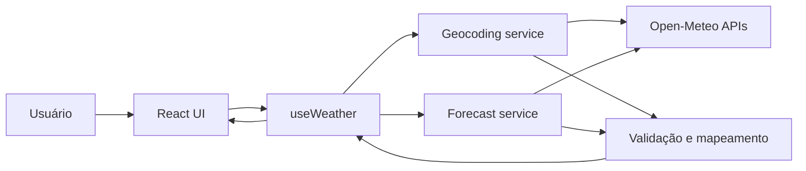

# Weather App — Plano Técnico

**Fonte:** `specs/weather-app-spec.md`  
**Status:** Proposta técnica derivada da spec. Não é código de produção. As questões listadas em “Open Questions” na spec permanecem gates para fechar contratos e aprovar o lançamento.

## Architecture

Aplicação web client-side, sem autenticação nem persistência em servidor. A UI não acessa URLs ou interpreta diretamente payloads externos: um hook orquestra o fluxo e serviços isolam as chamadas Open-Meteo; mapeadores convertem as respostas para modelos internos.



- **Apresentação:** componentes React para busca, dados atuais, previsão, unidade e estados de carregamento/erro/vazio.
- **Orquestração:** `useWeather` controla busca, cidade selecionada, consultas e estados assíncronos.
- **Serviços:** funções específicas para geocoding e previsão; encapsulam `fetch`, timeout e erros HTTP/rede.
- **Domínio:** tipos compartilhados, conversão de temperatura e formatação de datas/unidades.
- **Integração:** chamadas do navegador diretamente às APIs Open-Meteo. Essa opção é simples e compatível com a ausência de API key; requer confirmar CORS, termos, limites e divulgação de envio da busca ao provedor.

## Tech Stack

Usar dependências já presentes no repositório, sem adicionar bibliotecas de estado ou de consulta:

- TypeScript em modo strict, React e Vite para a aplicação.
- Tailwind CSS para estilos, seguindo as instruções locais de frontend.
- Vitest e Testing Library para testes unitários e de componentes.
- Playwright para testes E2E.
- Biome para lint e formatação; pnpm como gerenciador.
- APIs públicas Open-Meteo para geocoding e previsão, sem API key.

A conversão e os cálculos de domínio permanecem em Celsius; a conversão para Fahrenheit ocorre na apresentação e não dispara nova consulta, conforme a decisão arquitetural registrada no README.

## Project Structure

Estrutura planejada, alinhada ao README e às convenções do projeto:

```text
src/
├── components/
│   ├── states/                 # Loading, erro e vazio
│   ├── WeatherSearch.tsx       # Entrada e resultados de cidades
│   ├── CurrentWeather.tsx      # Condições atuais
│   ├── ForecastList.tsx        # Cinco dias
│   └── TemperatureUnitToggle.tsx
├── hooks/
│   └── useWeather.ts           # Estado e orquestração da consulta
├── services/
│   ├── openMeteoGeocoding.ts   # Busca de cidades
│   ├── openMeteoForecast.ts    # Clima atual e previsão
│   └── openMeteoMapper.ts      # Validação e normalização de payloads
├── lib/
│   ├── temperature.ts         # Conversões puras
│   └── date.ts                # Formatação de datas locais
├── types/
│   └── weather.ts             # Contratos internos
├── styles/
│   └── index.css
├── App.tsx
└── main.tsx

tests/
├── unit/                       # Domínio, serviços e componentes
└── e2e/                        # Fluxos de usuário com Playwright
```

Não criar backend nesta entrega: a spec exige ausência de persistência no servidor e não requer autenticação. Se limites, privacidade ou políticas do provedor exigirem proxy, isso deve voltar à decisão de arquitetura antes da implementação.

## Data Model

Contratos internos normalizados, sem expor tipos do provedor à UI. Os campos abaixo refletem variáveis disponíveis na Open-Meteo; os campos que a UI deve exibir ainda dependem de OQ-02.

```ts
export type Unit = "celsius" | "fahrenheit";

export interface City {
  id?: number;
  name: string;
  adminRegion?: string;
  country?: string;
  countryCode?: string;
  latitude: number;
  longitude: number;
}

export interface CurrentWeather {
  temperatureC: number;
  apparentTemperatureC?: number;
  relativeHumidityPercent?: number;
  isDay?: boolean;
  precipitationMm?: number;
  weatherCode?: number;
  windSpeedKmh?: number;
  windDirectionDegrees?: number;
}

export interface ForecastDay {
  date: string;
  minTemperatureC?: number;
  maxTemperatureC?: number;
  precipitationProbabilityPercent?: number;
  precipitationSumMm?: number;
  weatherCode?: number;
  maxWindSpeedKmh?: number;
}

export interface WeatherData {
  city: City;
  timezone: string;
  current: CurrentWeather;
  forecast: ForecastDay[];
}

export type AsyncState<T> =
  | { status: "idle" }
  | { status: "loading" }
  | { status: "success"; data: T }
  | { status: "empty" }
  | { status: "error"; error: WeatherError };

export type WeatherError =
  | { kind: "network" }
  | { kind: "timeout"; timeoutMs: number }
  | { kind: "http"; status: number; retryable: boolean }
  | {
      kind: "invalid-response";
      reason: "malformed-json" | "missing-current-temperature" | "invalid-forecast";
    };

export interface WeatherViewState {
  query: string;
  search: AsyncState<City[]>;
  selectedCity: City | null;
  weather: AsyncState<WeatherData>;
  unit: Unit;
}
```

- `City.id` é opcional porque pode não existir em todo resultado; validar coordenadas/nome e usar latitude/longitude como chave de fallback na sessão.
- `timezone` vem dos metadados da resposta de previsão; o uso de `timezone=auto` é a proposta técnica para obter datas locais, pendente de confirmação em OQ-03.
- `forecast` deve conter exatamente cinco itens ordenados por `date` após normalização; a seleção dos campos diários para a UI está pendente de OQ-02.
- Resultado de geocoding sem cidades é uma lista vazia (`empty`), não um erro de transporte.
- As temperaturas internas são Celsius; `Unit` controla apenas a apresentação. Campos meteorológicos opcionais podem estar ausentes em respostas parciais.

## Data Flow

1. O usuário envia um termo de cidade; a camada de UI encaminha a ação para `useWeather`.
2. O hook inicia o estado de busca e chama o serviço de geocoding.
3. O serviço monta a requisição Open-Meteo, valida HTTP e JSON e mapeia resultados para `City[]`.
4. Lista vazia produz estado `empty`; falha técnica produz estado `error`; resultados são apresentados para seleção.
5. Ao selecionar uma cidade, o hook inicia a consulta de clima atual e previsão para suas coordenadas.
6. O serviço de previsão solicita cinco datas, normaliza temperaturas para Celsius e associa o fuso retornado. Variáveis diárias aguardam OQ-02; o fuso final aguarda OQ-03.
7. O hook publica `WeatherData`; a UI apresenta cidade, temperatura atual e cinco datas.
8. Alterar a unidade atualiza somente a apresentação com conversão pura; não repete a chamada de rede.
9. Uma nova seleção substitui os dados da cidade anterior. Respostas atrasadas de uma seleção anterior não podem sobrescrever a cidade ativa; cancelar requisições obsoletas com `AbortController` é a abordagem proposta.

## External APIs

### Geocoding Open-Meteo

- **URL:** `https://geocoding-api.open-meteo.com/v1/search?name={query}&count={limit}&language=pt&format=json`
- **Parâmetros:** `name` é o termo de cidade; `count` limita resultados; `language=pt` solicita nomes em português quando disponíveis; `format=json` solicita JSON.
- **Exemplo resumido de resposta:**

```json
{
  "results": [
    {
      "id": 3448433,
      "name": "São Paulo",
      "latitude": -23.5505,
      "longitude": -46.6333,
      "country_code": "BR",
      "country": "Brasil",
      "admin1": "São Paulo"
    }
  ],
  "generationtime_ms": 0.2
}
```

- **Mapeamento:** `results[].id` → `City.id`; `name` → `name`; `admin1` → `adminRegion`; `country` → `country`; `country_code` → `countryCode`; `latitude`/`longitude` → coordenadas. Não usar índice da lista como identidade. `results` ausente ou vazio numa resposta válida sem correspondências normaliza para `City[]` vazio.
- **Contrato interno:** `Promise<City[]>`. O limite de resultados e as regras para desambiguar nomes iguais dependem de OQ-01.

### Forecast Open-Meteo

- **URL:** `https://api.open-meteo.com/v1/forecast?latitude={lat}&longitude={lon}&current=temperature_2m,apparent_temperature,relative_humidity_2m,is_day,precipitation,weather_code,wind_speed_10m,wind_direction_10m&daily=weather_code,temperature_2m_max,temperature_2m_min,precipitation_probability_max,precipitation_sum,wind_speed_10m_max&forecast_days=5&timezone=auto&temperature_unit=celsius&wind_speed_unit=kmh&precipitation_unit=mm`
- **Parâmetros relevantes:** `latitude`/`longitude` vêm da cidade selecionada; `current` e `daily` selecionam variáveis; `forecast_days=5` solicita hoje e os quatro dias seguintes; `timezone=auto` solicita o fuso local das coordenadas (proposta ainda pendente de OQ-03); unidades fixas mantêm a normalização interna em °C, km/h e mm.
- **Variáveis pendentes de validação de produto:** o conjunto `current`/`daily` abaixo cobre campos disponíveis e contratos propostos. Confirmar quais campos diários e atuais devem ser apresentados em OQ-02 antes de fixar a requisição de produção.
- **Exemplo resumido de resposta:**

```json
{
  "latitude": -23.55,
  "longitude": -46.63,
  "timezone": "America/Sao_Paulo",
  "current_units": {
    "temperature_2m": "°C",
    "apparent_temperature": "°C",
    "relative_humidity_2m": "%",
    "precipitation": "mm",
    "wind_speed_10m": "km/h"
  },
  "current": {
    "time": "2026-11-05T12:00",
    "temperature_2m": 18.2,
    "apparent_temperature": 19.1,
    "relative_humidity_2m": 72,
    "is_day": 1,
    "precipitation": 0.0,
    "weather_code": 2,
    "wind_speed_10m": 8.4,
    "wind_direction_10m": 120
  },
  "daily_units": {
    "time": "iso8601",
    "temperature_2m_max": "°C",
    "temperature_2m_min": "°C",
    "precipitation_probability_max": "%",
    "precipitation_sum": "mm",
    "wind_speed_10m_max": "km/h"
  },
  "daily": {
    "time": ["2026-11-05", "2026-11-06", "2026-11-07", "2026-11-08", "2026-11-09"],
    "weather_code": [2, 3, 61, 1, 0],
    "temperature_2m_max": [23.0, 22.1, 20.4, 24.0, 25.2],
    "temperature_2m_min": [16.0, 15.2, 14.8, 16.3, 17.1],
    "precipitation_probability_max": [10, 20, 70, 5, 0],
    "precipitation_sum": [0.0, 0.2, 4.1, 0.0, 0.0],
    "wind_speed_10m_max": [12.0, 14.0, 18.0, 11.0, 10.0]
  }
}
```

- **Mapeamento para `WeatherData`:** o objeto de cidade selecionada permanece como `city`; raiz `timezone` → `timezone`; `current.temperature_2m` → `current.temperatureC`; `apparent_temperature` → `apparentTemperatureC`; `relative_humidity_2m` → `relativeHumidityPercent`; `is_day` (`1`/`0`) → `isDay` (`true`/`false`); `precipitation` → `precipitationMm`; `weather_code` → `weatherCode`; `wind_speed_10m` → `windSpeedKmh`; `wind_direction_10m` → `windDirectionDegrees`.
- **Mapeamento dos arrays diários:** para cada índice `i`, criar um `ForecastDay`: `daily.time[i]` → `date`; `temperature_2m_min[i]`/`temperature_2m_max[i]` → `minTemperatureC`/`maxTemperatureC`; `precipitation_probability_max[i]` → `precipitationProbabilityPercent`; `precipitation_sum[i]` → `precipitationSumMm`; `weather_code[i]` → `weatherCode`; `wind_speed_10m_max[i]` → `maxWindSpeedKmh`. Validar que os arrays usados têm o mesmo comprimento e cinco datas antes de retornar `WeatherData`.
- **Unidade de interface:** `Unit` (`celsius` ou `fahrenheit`) não vem da API nem integra o payload meteorológico; permanece estado de apresentação. A requisição continua em Celsius e a conversão para Fahrenheit ocorre localmente.
- **Contrato interno:** `Promise<WeatherData>`; resposta HTTP não-2xx, JSON inválido, ausência de temperatura atual ou arrays diários inconsistentes são normalizados para `WeatherError`.

Ambas as APIs são chamadas sem API key. Antes do lançamento, confirmar termos de uso, atribuição, cobertura regional, limites, CORS e divulgação de que a cidade pesquisada é enviada a um serviço externo (OQ-08 e decisão de privacidade).

## State Management

- **Localização:** `useWeather`, consumido pela tela raiz, é o proprietário do estado efêmero da aplicação. Não usar estado global, backend ou persistência no servidor. Começar com `useState`; adotar `useReducer` somente se as transições crescerem a ponto de ficarem difíceis de manter.
- **Estados explícitos:** cada recurso assíncrono usa `AsyncState<T>` com `idle` (ainda não solicitado), `loading` (request pendente), `success` (resposta válida com dados), `empty` (busca concluída sem cidades) e `error` (falha tipada). Manter `search` e `weather` independentes: a busca pode apresentar resultados enquanto a previsão está carregando.
- **Estado da tela:** `WeatherViewState` contém `query`, `search`, `selectedCity`, `weather` e `unit`. Nova busca altera apenas `search`; selecionar uma cidade define `selectedCity`, limpa `weather` da seleção anterior e inicia `loading` para o novo local.
- **Regra de vazio:** `empty` é válido para geocoding sem resultados. Resposta de forecast sem cinco datas ou sem a temperatura atual obrigatória é `error: invalid-response`, não `empty`.
- **Conversão de unidade:** `WeatherData` mantém temperaturas em Celsius. `unit` começa em `celsius`; um seletor puro calcula os valores exibidos em Fahrenheit durante a renderização. Não mutar os dados de origem, não fazer nova chamada ao alternar e reaplicar a formatação aos valores atuais e diários exibidos.
- **Persistência:** até OQ-05 ser fechada, termo, cidade selecionada, resultados, dados e unidade permanecem somente na memória da sessão; não usar `localStorage` nem persistência no servidor.
- **Concorrência:** cancelar/ignorar requests obsoletos ao mudar a consulta ou selecionar outra cidade. O cancelamento esperado não vira `error`; uma resposta antiga nunca substitui os dados da seleção atual.
- **Responsabilidades:** componentes recebem estado e callbacks; o hook coordena transições; serviços retornam dados normalizados ou erros tipados e não leem estado React.

## Error Handling

- **Rede:** rejeição de `fetch` sem resposta HTTP (offline, DNS ou conexão interrompida) vira `error: network`. Encerrar o loading do recurso afetado e apresentar mensagem em pt-BR com ação de tentar novamente.
- **HTTP/API:** resposta não-2xx vira `error: http`, preservando o status para tratamento interno. Classificar `429` e `5xx` como potencialmente retentáveis; demais status não recebem retry automático. Não exibir o payload bruto do provedor.
- **Timeout:** usar timeout cancelável de **10 segundos por request** como valor proposto. Ao expirar, abortar o request e emitir `error: timeout`; cobrir com fake timers. Ratificar o limite em OQ-06/OQ-09 antes do aceite de produção.
- **JSON inválido:** erro de parsing vira `error: invalid-response` com `reason: malformed-json`.
- **Resposta parcial:** campos meteorológicos opcionais ausentes permanecem `undefined`; a UI os omite ou indica indisponibilidade, sem inventar valores nem convertê-los em zero. Ausência da temperatura atual, das cinco datas, ou inconsistência nos arrays diários invalida o snapshot e gera `invalid-response` (`missing-current-temperature` ou `invalid-forecast`). Essa regra mantém os mínimos já exigidos pela spec; campos adicionais aguardam OQ-02.
- **Busca sem resultados:** geocoding válido sem correspondências vira `empty`, mantém o termo pesquisado e não inicia forecast; não é erro de API.
- **Dados anteriores:** ao selecionar nova cidade, limpar o snapshot anterior para evitar atribuição ao local errado. Sem cache nesta proposta; nunca mostrar dados antigos como atuais sem identificá-los.
- **Retry:** proposta: sem repetição automática; disponibilizar ação manual “Tentar novamente” para `network`, `timeout`, `429` e `5xx`. Busca vazia não oferece retry; payload inválido exige nova consulta após correção/alteração. Confirmar política com OQ-06.
- **Cancelamento:** abort por nova busca/seleção não muda o estado para erro e não gera mensagem.
- **Apresentação:** mensagens devem ser acionáveis, em pt-BR, sem stack traces, URLs internas ou detalhes técnicos brutos.

## Testing Strategy

- **Unitários (Vitest):** conversão °C→°F e °F→°C com casos `0 °C → 32 °F` e `100 °C → 212 °F`; verificar que alterar `unit` só recalcula a apresentação, preserva o snapshot e não chama serviço; cobrir formatação de datas com relógio/fuso fixos.
- **Serviços (Vitest):** mock de `fetch`; validar query params e mapeamentos; testar geocoding vazio, falha de rede, HTTP não-2xx e classificação de retry, timeout de 10 s com fake timers, JSON inválido, campos opcionais ausentes, temperatura obrigatória ausente, menos de cinco datas e arrays diários com comprimentos inconsistentes. Nunca chamar a API real.
- **Componentes (Testing Library):** renderizar estados `idle`, `loading`, `success`, `empty` e `error`; verificar mensagens acessíveis, resultados de cidade, clima atual, cinco datas e valores Celsius/Fahrenheit; confirmar que a troca de unidade não aciona nova consulta.
- **Integração do hook:** testar a sequência geocoding → seleção → forecast e garantir que uma resposta atrasada não substitui a seleção mais nova.
- **E2E (Playwright):** interceptar Open-Meteo via `page.route`; cobrir busca, seleção, clima atual, cinco dias, troca de unidade, nenhum resultado, falha/timeout e viewport móvel. Fixtures determinísticas e relógio controlado para datas.
- **Rastreabilidade:** cada teste deve referenciar os IDs de AC/US cobertos. Critérios de NFR-02, NFR-05 e NFR-06 não são gates automatizados completos até suas metas serem fechadas.
- **Comandos:** `pnpm test`, `pnpm test:e2e`, `pnpm lint`, `pnpm build`.

## Risks & Trade-offs

| Risco ou trade-off | Consequência | Resposta proposta |
|---|---|---|
| A spec ainda não define variáveis atuais/diárias (OQ-02) | Não é possível finalizar o payload do forecast nem os componentes de exibição | Bloqueia o fechamento do contrato de API e as tarefas de UI de dados; resolver antes da implementação funcional. |
| Fuso das cinco datas está aberto (OQ-03) | Risco de previsão começar no dia incorreto | Propor `timezone=auto` e datas civis do local; validar e registrar a decisão na spec. |
| Chamadas diretas do browser ao Open-Meteo | Simplicidade e ausência de backend, mas dependência de CORS/termos/limites e envio da busca a terceiro | Validar OQ-08 e privacidade antes do lançamento; considerar proxy apenas se uma restrição concreta exigir. |
| Sem cache | Dados sempre dependem de rede; falha externa reduz disponibilidade percebida | Começar sem cache para evitar dados desatualizados e complexidade; confirmar com produto em OQ-06. |
| Persistência local de unidade indefinida (OQ-05) | Comportamento entre visitas não pode ser implementado sem decisão | Manter em memória até a spec aprovar armazenamento local. |
| Metas mobile, acessibilidade, desempenho e disponibilidade pendentes | Não há critérios completos para declarar conformidade de produção | Resolver OQ-07/OQ-09 e adicionar critérios verificáveis à spec antes do aceite final. |
| Limites e termos do provedor ainda não validados (OQ-08) | Mudança de provedor ou arquitetura pode ser necessária após a implementação | Confirmar termos, atribuição, cobertura e limites antes do lançamento; manter o serviço encapsulado. |
